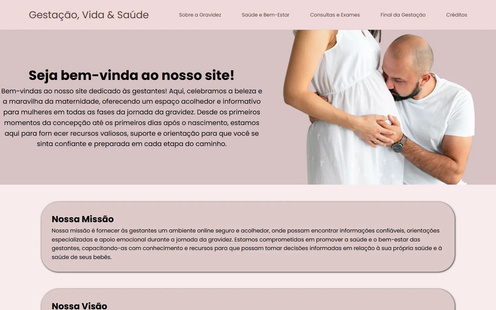

<div align="center">

# 🤰 Mãe♡Guia

**Site informativo para gestantes e mães de primeira viagem**


[](LICENSE)
[](https://kevinlopes23.github.io/M-eGuia/)

<br>



</div>

## 💡 Sobre

Portal com informações acessíveis sobre a gravidez, do início da gestação ao pós-parto, voltado a mães com pouco acesso a informação de qualidade.

## ✨ Conteúdo

- Sobre a gravidez: desenvolvimento do bebê semana a semana
- Saúde e bem-estar: alimentação (macro e micronutrientes) e sintomas comuns
- Consultas e exames: hemograma, ultrassonografia, eletrocardiograma e como escolher profissionais
- Final da gestação: tipos de parto, plano de parto e pós-parto
- Página de contato e página 404 personalizada

## 🛠️ Tecnologias

HTML5 · CSS3 · Google Fonts (Poppins)

## 🚀 Como rodar

```bash
git clone https://github.com/KevinLopes23/M-eGuia.git
```

Abra `html/index.html` no navegador. (O repositório tem ~118 MB por causa das imagens.)

## 📄 Licença

Distribuído sob a licença MIT. Veja [LICENSE](LICENSE).

## 👤 Autor

Feito por [Kevin Lopes](https://github.com/KevinLopes23)
